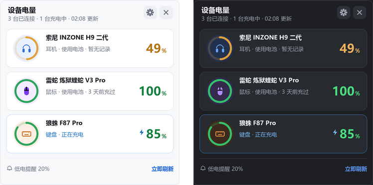
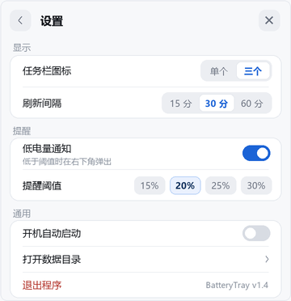

<div align="center">

# BatteryTray

**在 Windows 任务栏盯住三台 2.4G 无线设备的电量 —— 不用装厂商全家桶，也不用翻设置页。**

[](https://github.com/Amhertx/BatteryTray/releases)
[](#下载)
[](#从源码运行)
[](#下载)
[](LICENSE)

**[⬇ 下载最新版](https://github.com/Amhertx/BatteryTray/releases/latest)** · [功能](#功能) · [使用](#使用) · [常见问题](#常见问题) · [从源码运行](#从源码运行) · [协议细节](docs/PROTOCOL.md)



<sub>左：浅色 · 右：深色（跟随系统）</sub>

</div>

## 这个工具解决什么问题

索尼 INZONE H9 二代、雷蛇 炼狱蝰蛇 V3 Pro、狼蛛 F87 Pro 在 Windows 上**都没有原生电量 API** ——
`Get-PnpDevice -Class Battery` 里看不到它们，`root\wmi` 下也没有对应的 `BatteryStatus`。
想知道还剩多少电，只能开 INZONE Hub 或雷云。

BatteryTray 直接读这三家自己的 HID 通道，把结果塞进任务栏：**一个图标一台设备，底部那条就是电量**。

## 功能

- **三台设备各一个托盘图标**，形状 + 颜色区分（蓝耳机 / 紫鼠标 / 橙键盘），底部电量条长度＝电量，颜色随高低变绿→琥珀→红
- **充电看得出来**：电量条会从「当前电量往下 30 个点」慢慢爬到当前电量，停住的位置就是真实电量，扫一眼就知道充到几 %（[看动画](docs/charge.gif)）
- **点击弹出面板**：一台设备一张卡片，左边电量环包围设备图形，右边大号百分比，副标题写「设备类型 · 状态 · 距上次充电几天」
- **重启后不空白**：开机自启时设备往往还没醒，面板先顶上次读到的电量，灰色标注「上次读数 · N 小时前」，醒来后自动换成实时值
- **面板内直接设置**：任务栏图标单/三、刷新间隔、低电提醒与阈值、开机自启、退出，不用翻右键菜单
- **跟随系统深浅色**，Win11 原生圆角，上滑 + 渐显动画，不在任务栏多出一个窗口
- **纯本地、只读**：不联网、不上报、不改设备配置，与雷云 / INZONE Hub 共存
- 单文件 exe，19 MB，免安装，不需要 Python 或运行库

## 下载

**Windows 10 / 11 x64**，单文件绿色版，双击即用：

[**⬇ BatteryTray.exe（最新版）**](https://github.com/Amhertx/BatteryTray/releases/latest) · [全部版本](https://github.com/Amhertx/BatteryTray/releases)

> exe 没有代码签名，首次运行 Windows 会拦一下：点「更多信息」→「仍要运行」。
> 想自己编译也行，见[从源码运行](#从源码运行)。

启动后图标出现在右下角通知区。如果只看到 `^` 溢出面板里躺着它，把它拖到任务栏上就行 ——
Windows 11 默认折叠所有新注册的通知区图标，程序无法用 API 强制展开，拖一次之后系统会永久记住。

## 使用

| 操作 | 结果 |
|---|---|
| **左键**托盘图标 | 弹出面板 |
| **悬停**托盘图标 | 提示框列出三台电量 |
| **右键**托盘图标 | 菜单：打开面板 / 立即刷新 / 显示方式 / 低电量提醒 / 开机自启 / 退出 |
| 点面板里的**某张卡片** | 只刷新那台设备 |
| 点右上角 **⚙** | 进设置页 |
| 点右上角 **×** | 收起面板（程序继续在托盘运行） |
| `Esc` | 设置页 → 主面板 → 收起 |
| 点面板外 | 自动收起 |

默认 **30 分钟**采集一次；设备休眠或耳机没开时降到 **5 分钟**重试，设备醒来后很快补上。

### 托盘图标怎么读

<div align="center"></div>

- 图形是设备类型，颜色区分设备，**底部那条是电量条**，长度就是百分比
- 充电时**同一个颜色**从低位匀速补到当前电量，到顶停 1.2 秒再来一轮。位移量固定（16px 下约 4px），
  所以 99% 也看得见在动；每一轮**停住的位置正好是真电量**
- 电量低于 30% 时条子本来就短，行程自动缩到「0 → 当前电量」，从空里长出来，相对变化一样是满幅
- 设备离线变灰

### 设置项一览

<div align="center"></div>

| 分组 | 项目 | 可选 |
|---|---|---|
| 显示 | 任务栏图标 | 单个（一个电池图标按最低电量填充） / 三个（每台一个） |
| 显示 | 刷新间隔 | 15 / 30 / 60 分钟 |
| 提醒 | 低电量通知 | 开 / 关 |
| 提醒 | 提醒阈值 | 15% / 20% / 25% / 30% |
| 通用 | 开机自动启动 | 开 / 关（写 `HKCU\...\Run`，可随时撤销） |
| 通用 | 打开数据目录 / 退出程序 | — |

低电量通知**同一台设备只弹一次**；电量回升到「阈值 + 5%」以上、或插上电再拔掉，才会重新武装，
避免在临界值反复骚扰。

**多台同时低于阈值时，每台都会弹自己的那条**（走各自托盘图标的通知通道 —— 同一个图标连发两条，
Windows 会用后一条顶掉前一条，这也是早期只看到一条的原因）。切到单图标模式后就只剩一个通知通道，
此时并成一条汇总：「设备电量偏低：键盘 15%、鼠标 18%」。

## 常见问题

<details>
<summary><b>托盘里根本找不到图标</b></summary>

Windows 11 把新注册的通知区图标默认折叠进 `^`。点任务栏的 `^`，把 BatteryTray 的图标拖到任务栏上即可，
系统会永久记住（写 `NotifyIconSettings\IsPromoted`）。程序启动时也会补这条标记，所以换路径重装后下次登录直接可见。
首次启动还会弹一条通知提示图标位置。
</details>

<details>
<summary><b>某台设备显示「休眠」或「离线」</b></summary>

休眠是正常的：鼠标闲置后进入低功耗，只回「设备未就绪」，键盘插线充电时也可能不应答 2.4G 查询。
程序按休眠显示并每 5 分钟重试，动一下鼠标 / 敲一下键就恢复。耳机没开机时只剩接收器在，读不到电量属于正常现象，
界面会保留「上次 xx%」不丢信息。
</details>

<details>
<summary><b>会不会和我装的雷云 / INZONE Hub 冲突</b></summary>

不会。程序只发只读查询，HID 句柄共享打开，不独占通道；并显式封禁了两条会改设备模式的命令
（`SET_DEVICE_MODE` 和索尼的 `MODE=0x02`）。详见 [docs/PROTOCOL.md](docs/PROTOCOL.md)。
</details>

<details>
<summary><b>开机后显示的是「上次读数」，不是现在的电量</b></summary>

正常设计。刚重启时键鼠多半还在休眠、耳机没开机，HID 一条也读不到。程序把最后一次**真正读到**的电量
存进 `last_readings.json`，启动时先顶上，并在卡片右侧用灰色数字 + 「上次读数」、副标题写「N 小时前」标清楚。
设备醒来后的下一轮采集就会换成实时值。缓存值**不参与低电量提醒**，所以不会出现关机一晚、开机就误报。
</details>

<details>
<summary><b>「x 天前充过」是怎么算的</b></summary>

每次采集看到某台设备在充电，就把当天日期记进 `%APPDATA%\BatteryTray\charge_history.json`，
之后按**本地日历日**求差取整数天，所以昨天深夜充、今天凌晨看就是 1 天。
程序没运行时发生的充电无法感知，只记它亲眼看到的，首次启用会从空白开始积累，没记录时显示「暂无记录」。
</details>

<details>
<summary><b>会上传数据吗 / 数据存在哪</b></summary>

不联网，没有任何遥测。全部文件都在 `%APPDATA%\BatteryTray\`：

```
config.json          设置
charge_history.json  最近一次看到充电的日期（算天数用）
last_readings.json   最后一次真正读到的电量（重启后先顶上用）
audit.log            HID 收发与拦截记录，可自行核对
error.log            仅在有崩溃时出现
```
</details>

<details>
<summary><b>能加我自己的设备吗</b></summary>

目前三台是写死并实测过的，加设备需要先逆向它的报文格式，参考 [docs/PROTOCOL.md](docs/PROTOCOL.md)
里的写法和 `btray/providers.py`。没有通用方案 —— 每家厂商的 HID 协议都不一样。
</details>

## 从源码运行

需要 Python 3.12：

```bat
pip install -i https://mirrors.aliyun.com/pypi/simple/ hidapi pystray pillow
python run.pyw
```

打包成单文件 exe（PyInstaller）：

```bat
python -m PyInstaller --noconfirm --clean --onefile --windowed --name BatteryTray ^
  --icon app.ico --hidden-import pystray._win32 --hidden-import PIL._tkinter_finder ^
  --exclude-module numpy --exclude-module matplotlib run.pyw
```

### 项目结构

```
btray/
  app.py          入口、单实例、托盘与面板的接线
  config.py       默认配置、版本号、日志路径
  hidio.py        只读 HID 传输层（白名单 / 封禁表 / 审计）
  providers.py    三个厂商的报文解析
  service.py      采集调度：缓存、退避、插拔、按设备单独刷新
  history.py      充电历史：记「看到在充电」的日期，算整数天数
  cache.py        上次读数：落盘最后一次真正读到的电量，重启后先顶上
  model.py        统一读数模型
  icons.py        托盘图标（64 画布绘制 → BOX 缩到 16px + 充电动画）
  tray.py         pystray 托盘、菜单、动画泵
  panel.py        弹出面板：卡片列表 + 设置页 + 动画
  theme.py        设计令牌：浅 / 深两套配色
  glyphs.py       面板内矢量图形
  diag.py         异常钩子：写 error.log
  notify_area.py  把通知区图标标记为常显

tools/            开发期自检（都不影响主程序）
  selftest.py     用真实设备跑一轮采集并打印
  watch.py        协议探针：scan / query / aula / sony
  uipreview.py    假数据渲染面板，导出明暗 × 首页/设置 预览
  uismoke.py      交互冒烟：点每个控件看是否调到对应动作
  animsmoke.py    充电动画冒烟：相位推进、只重画充电中的设备
  historytest.py  充电天数计算
  cachetest.py    上次读数缓存 + 多设备低电量通知
  docimg.py       生成 README 配图
```

### 面板为什么不用 Tk 原生控件

Tk Canvas 的 `arc` / `oval` / `polygon` 没有抗锯齿，100% DPI 下圆角和开关全是台阶，参数调不出来。
所以整块面板用 PIL 在 **2 倍画布**上绘制，再 `LANCZOS` 缩到 1:1；电量环单独做 **8 倍**局部超采样
（环的中线在 `r - w/2`，直接按 `r` 摆圆头会顶出半个线宽，两端各冒一个小凸点）。

托盘图标只有 16×16，按 64 画布 4 倍超采样后用 **BOX**（面积平均）降采样，比 `LANCZOS` 更干脆、不在边缘振铃；
图形特征一律 ≥8 个 64 空间单位（＝2px），键盘用 3 大键 × 2 行 + 空格键，而不是 8 个小键 —— 小键缩下来只是一排噪点。

## 已知限制

- 双模键盘插线充电时可能切到有线模式并断开 2.4G，此时读不到电量属于硬件行为。
- 耳机开机后第一次采集可能要等一轮退避（最长 5 分钟），点卡片可立刻重试。
- 只支持 Windows；托盘与通知依赖 `pystray` / Win32 API。
- 三台设备是写死的，不支持自动发现新设备。

## 许可

[MIT](LICENSE) © 2026 Amhertx

随便用：可以读、改、合并、发布、商用、再授权，只要保留版权声明和许可声明。
软件按「原样」提供，不附带任何担保 —— 拿它去读你自己的设备，风险自负。

---

<sub>协议逆向、只读边界与排错方法见 [docs/PROTOCOL.md](docs/PROTOCOL.md)。</sub>
